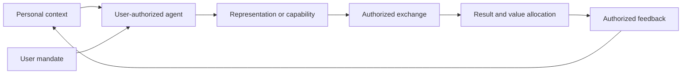

# Silicon Dreamers Protocol (SDP)

**A protocol for personal information value exchange through user-authorized AI agents.**

Draft `0.2.0-draft.1` · [Protocol specification](spec/SDP-0001-core.md)

A person's experience, preferences, knowledge, intentions and judgment carry value. A personal agent can interpret that context and turn it into something another person or system can use: an answer, a creative work, a service, a request, a decision or an authorized action.

**SDP describes how that value leaves private context, enters an authorized exchange, and returns to the person as a result, benefit or new understanding.**

The exchange may involve information, capability, execution rights, compensation or collaboration. It need not involve raw-data disclosure, an NFT, a payment or a blockchain.

## The central relationship



The feedback arrow is permissioned. Participation does not automatically authorize writing counterparties' information into memory.

A personal agent is an agent authorized to represent a principal within a defined scope. It can run locally or through a hosted service. Its location, model vendor or brand does not by itself establish authority.

## What SDP defines

| Concept | Protocol question |
|---|---|
| **Principal** | Whose interests and authority does the agent represent? |
| **Context** | What information can it access, and for what purpose? |
| **Mandate** | What may it infer, disclose, invoke, delegate or spend? |
| **Representation** | What leaves the private boundary: a result, offer, capability or selected information? |
| **Exchange agreement** | What is each party committing to provide, receive and permit? |
| **Execution receipt** | What happened, under which authorization, and with what evidence? |
| **Value allocation** | Who receives the result, payment, credit, access or other benefit? |
| **Feedback** | What may be retained or returned to the principal's agent? |

The core contribution is the link between personal context, bounded agent representation, external exchange and attributable outcomes. Application-specific assets and execution rights are expressed through profiles.

## Developer authority is bounded

Developers provide applications, policies, interfaces and infrastructure. Administrator status alone does not grant authority to disclose personal context, execute a user's transaction, redirect their result or exercise a capability assigned to them.

Agents receive bounded autonomy from the principal. A developer signature, successful login or model response cannot substitute for that authorization. Profiles must explain which limits are enforced by code, which depend on an operator, and which are only attested by an agent.

See [Authority and AI execution](spec/SDP-0002-authority-and-ai.md).

## Application examples

- **Knowledge collaboration:** experience becomes a scoped answer or service; private source material stays within the permitted boundary.
- **Intent matching:** preferences and constraints become a minimal request that can be matched without publishing a full personal profile.
- **Agent-to-agent work:** one agent delegates a bounded subtask; the recipient receives only the permitted inputs and execution rights.
- **Creative issuance:** personal context becomes a work, with an explicit publication or mint entitlement.
- **[Agent-created tokens](cases/agent-created-token/README.md):** personal intent and community context become a token concept, an authorized creation plan and an explicit allocation of units and control.

The earlier NFT, mint-entitlement and seat-succession design is preserved in [the agent-created NFT case](cases/agent-created-nft/README.md). It is one application of SDP, not the definition of the protocol.

## Repository map

| Document | Purpose |
|---|---|
| [Core](spec/SDP-0001-core.md) | Participants, objects, operations, exchange lifecycle and invariants |
| [Authority and AI](spec/SDP-0002-authority-and-ai.md) | Personal-agent delegation, privacy and non-discretionary developer powers |
| [Exchange and rights](spec/SDP-0003-exchange-and-rights.md) | Use, delegation, assignment, execution and value allocation |
| [Architecture](docs/architecture.md) | Components, trust boundaries and interaction sequences |
| [Security](docs/security.md) | Disclosure, prompt injection, replay, revocation and operator risks |
| [Application profiles](cases/README.md) | How examples map to the core |
| [Mandate schema](schemas/mandate.schema.json) | A deliberately narrow draft authorization envelope |
| [Example exchanges](examples/exchanges.json) | Synthetic, non-executable scenarios |
| [Validation](docs/validation.md) | Local structural and consistency checks |
| [Authorship](AUTHORS.md) | Origin and attribution |
| [Changelog](CHANGELOG.md) | Scope changes |

## Status and validation

This is a complete first repository draft of a proposed protocol, not a deployed network, audited implementation or established interoperability standard. The wire profile is provisional. Its version is independent of any application's deployment version.

```sh
python tools/validate.py
```

The standard-library validator checks local links, mandate structure, example references and authorization-boundary fixtures. It does not execute an exchange, verify a signature or prove an application's privacy or autonomy guarantees.

Protocol concept attribution: **Silicon Dreamers Protocol**. See [contribution guidance](CONTRIBUTING.md) and [rights status](RIGHTS.md). Repository: [Agent-SDP404/sdp-protocol](https://github.com/Agent-SDP404/sdp-protocol).
