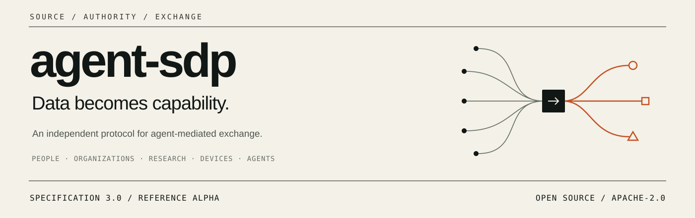

<p align="center"></p>

# agent-sdp

**A protocol for turning data into capabilities, exchanges and attributable outcomes through agents.**

[Specification 3.0.0](spec/SDP-0001-core.md) · [Run the reference alpha](#run-an-exchange) · [Apache-2.0](LICENSE) · [Release notes](releases/v3.0.0.md)

Data comes from people, organizations, public sources, research, devices, environments and other agents. agent-sdp describes how an Agent can use that data under its source conditions, agree on an exchange, execute a bounded capability and return verifiable results to the right recipients.

**Source rules travel into the task. Authority travels with the action. Evidence travels with the result.**

## The exchange path

**Data sources → Agent processing → Agreed exchange → Result & rights → Authorized state update**

A data source and the principal authorizing a task may have different controllers. Both sets of conditions matter. Public availability does not imply unrestricted reuse, and operating an Agent does not automatically grant control over its inputs or outputs.

## Run an exchange

Python 3.10+; no wallet, API key or model account required. From this checkout:

```sh
python -m pip install -r requirements.txt
python -m agent_sdp.demo --output dist/demo-trace.json
python -m agent_sdp.verify_trace dist/demo-trace.json
```

The demo performs four signed exchanges and deliberately rejects a conflicting replay:

```text
exchange:research: DELIVERED
Exact replay: same receipt; no additional allowance consumed
Changed replay: IDEMPOTENCY_CONFLICT
exchange:token: DELIVERED
exchange:nft-genesis: DELIVERED
exchange:nft-successor: DELIVERED
```

**Real:** Ed25519 verification, accepted terms, source-policy checks, SQLite transactions, allowance consumption, assignment, revocation and signed receipts.

**Simulated:** NFT issuance/succession and token creation. These adapters operate on a local ledger; they do not mint on a blockchain or move funds. Agent processing is deterministic fixture logic, not a live model call.

Inspect the committed [public proof bundle](examples/traces/local-exchange.json), [walkthrough](docs/quickstart.md) and [enforcement matrix](docs/conformance.md). All demonstration data is synthetic; private keys are generated in memory and are never exported.

## What the protocol adds

| Layer | What agent-sdp makes explicit |
|---|---|
| Source | Origin, controller, use conditions, disclosure audience and snapshot identity |
| Authority | Who may invoke an Agent, for which purpose, inputs and recipients |
| Agreement | What parties accepted, which capability will run and who receives the result |
| Execution rights | Which finite right is consumed, delegated or assigned, without duplicating it |
| Evidence | Commitments connecting accepted terms, inputs, outputs and receipts |
| Feedback | Where a result may be retained or applied: knowledge base, system, device or Agent |

The reference profile demonstrates these relationships in one bounded setting. It does not claim to invent authentication, agent messaging or token standards. See [relationship to MCP, A2A and existing infrastructure](docs/positioning.md).

## Explore the applications

| Case | Data becomes | Try or inspect |
|---|---|---|
| Research and device observations | A scoped analytical result | [Signed research exchange](cases/data-exchange/README.md) |
| Agent-created NFTs | A new artifact and a succession right | [Genesis and successor trace](cases/agent-created-nft/README.md) |
| Agent-created tokens | An issuance plan, allocated units and explicit control | [Creation-right handoff and token trace](cases/agent-created-token/README.md) |
| Organization knowledge, matching and coordination | Answers, requests and delegated tasks | [Additional application patterns](cases/README.md) |

NFTs and tokens are two applications. The protocol is independent of both, and independent of the Silicon Dreamers NFT project. There is currently no separate protocol website; this repository is the primary reference.

## Read, build, verify

- [Core specification](spec/SDP-0001-core.md): source-aware actors, objects and lifecycle.
- [Agent authority](spec/SDP-0002-agent-authority.md): bounded autonomy and developer authority.
- [Exchange and rights](spec/SDP-0003-exchange-rights.md): acceptance, use, delegation, assignment and allocation.
- [Local wire profile](spec/SDP-0004-local-wire.md): concrete envelopes, signing bytes, state transitions and errors.
- [Wire schema](agent_sdp/schemas/wire.schema.json): sources, mandates, agreements, assignments, results, receipts and acknowledgements.
- [Architecture](docs/architecture.md), [security](docs/security.md), [validation](docs/validation.md), [roadmap](docs/roadmap.md).

```sh
python tools/check.py
```

## Status and compatibility

**Specification: 3.0.0. Reference implementation: alpha.** The local profile is executable; network transports, live models, chain adapters and distributed enforcement are not included. Claims and limitations are mapped in [the conformance matrix](docs/conformance.md).

The renamed, expanded data model and signed profile are not wire-compatible with v1 examples. See [migration and versioning](docs/versioning.md). The original [v1.0.0 release](https://github.com/Agent-SDP404/sdp-protocol/releases/tag/v1.0.0) remains unchanged.

## Participate

Start with [open engineering questions](docs/roadmap.md), then propose a specific profile or implementation improvement using [CONTRIBUTING.md](CONTRIBUTING.md). Report public specification issues through [GitHub Issues](https://github.com/Agent-SDP404/sdp-protocol/issues); do not publish credentials or exploitable private-system details.

Original repository materials are licensed under [Apache-2.0](LICENSE). See [NOTICE](NOTICE), [authorship](AUTHORS.md) and [rights scope](RIGHTS.md).
