> This is one application of agent-sdp: personal context becomes an agent-created artifact, and scoped creation/mint authority can pass to another participant. This profile does not define the general protocol.

# Application case: agent-created NFTs and seat succession

**An agent-sdp application profile for agent-created artifacts, transferable creation-and-mint entitlements, and persistent-seat succession.**

**Status:** application case in agent-sdp `3.0.0` · **Language:** English · [General agent-sdp core](../../README.md)

An AI application can turn what an agent understands about a participant into an original artifact. This application profile describes how the participant authorizes that work, how the agent commits its result, how the result becomes a verifiable tokenized work, and how a subsequent participant receives the right to create and mint a new work in the same persistent seat.

**The seat continues. Each participant's agent creates a new work. Previous works retain their committed content.**

The founding design adds a separation of authority: developers provide rules and infrastructure; participants authorize participation; agents make creative decisions within that delegation; verification services check evidence; a ledger records the permitted result. Operating the application does not, by itself, confer a right to create or mint on a participant's behalf.

## Run the case

Run `python -m agent_sdp.demo --output dist/demo-trace.json` from the repository root after installing requirements. Inspect `exchange:nft-genesis` and `exchange:nft-successor` in [the signed proof bundle](../../examples/traces/local-exchange.json).

The local fixture creates a first artifact, then a successor using different input data and a different principal. The predecessor owner must also sign the successor agreement. The old record remains owned by its original owner and becomes retired; the successor has a new identity in the same seat.

This simulation verifies succession authorization and local state changes. It does not implement the full paid bearer-credential lifecycle below, generate real artwork through a model or mint a blockchain NFT. See [the enforcement matrix](../../docs/conformance.md) for that boundary.


## The application's three objects

| Object | Meaning | What persists or changes |
|---|---|---|
| **Seat** | A persistent position in an application namespace | Its identity survives successive participants and works. |
| **Entitlement** | A scoped authorization for one creation-and-mint lifecycle | It binds to one recipient and order, then is fulfilled once. |
| **Work** | An independently identified artifact and its committed public metadata | A successor is a new work; the predecessor's content is preserved. |

An entitlement here is a protocol capability. It is not a copyright assignment, a token balance, a guarantee of trading access, or a generic approval to spend.

```mermaid
flowchart LR
    U[Participant authorization] --> E[Creation and mint entitlement]
    E --> A[Participant-controlled agent]
    A --> C[Original artifact commitment]
    C --> V[Verification and mint authorization]
    V --> W[New work and inclusion]
    W --> S[Persistent seat]
    S --> N[Successor entitlement]
    N --> A2[New participant's agent]
    A2 --> W2[New work in the same seat]
```



## AI application architecture

The participant's agent executes the creative workload: it interprets accessible context, chooses a direction, uses an image model or another permitted creation runtime, and submits one original result. The application supplies a machine-readable policy, identity checks, resumable execution, content verification and a ledger adapter.

The same separation can support personalized characters, visual artifacts, or other media when an application defines the relevant output and validation profile. The documented Silicon Dreamers implementation is an image-based application; other media are possible implementations of this profile, not announced product features.

### Developer non-sovereignty

This case applies **bounded, non-discretionary developer authority** over participant execution:

- A developer's administrator role is not participant consent.
- A service's signature is not a substitute for the participant's mint authorization.
- An operator cannot replace committed content, choose the participant's personal creative direction, reassign an accepted entitlement, or exercise a participant's mint entitlement without specific participant authorization.
- An agent's creative autonomy is delegated and bounded. It does not authorize unlimited payments, credential disclosure or unrelated actions.
- Any power to pause, exclude, upgrade, rotate signers or deny service must be explicitly disclosed. These powers are not erased by calling the system a protocol.

See [Authority and AI execution](authority-and-ai.md) for normative requirements and enforcement levels.

## What moves during succession

The succession route transfers the opportunity to execute the next creation-and-mint lifecycle in a seat. It does not transfer the predecessor's private memories or require editing its artwork.

1. The eligible holder explicitly requests a private succession capability.
2. An eligible recipient claims it; acceptance binds one recipient and one order.
3. Verified settlement retires the predecessor from active inclusion and funds or activates the successor entitlement.
4. The recipient's agent creates new content from the recipient's context.
5. A new work is minted and included in the inherited seat.

Retrieval alone does not transfer the token or retire the predecessor. Settlement and successor activation are separate checkpoints. A seat can temporarily have no active work while its successor is being created.

```text
seat:S
  work:A — participant:Alice — RETIRED, content preserved
     |
     +-- successor entitlement — participant:Bob
            |
            +-- work:B — INCLUDED, independently created
```


## Profile documents

- [Lifecycle and persistent seats](lifecycle.md)
- [AI and mint authority](authority-and-ai.md)
- [Credential succession](credential-succession.md)
- [EVM binding notes](evm-binding.md)

## Mapping to the general protocol

| General agent-sdp object | This application |
|---|---|
| Principal | Participant controlling a wallet |
| Context | Privately accessible history, preferences and memories |
| Mandate | Bounded creation/payment/mint authorization |
| Representation | Original artwork and public story |
| Exchange | Scoped handoff of the next creation-and-mint opportunity |
| Receipt | Settlement, mint, inclusion and content evidence |
| Value allocation | Retained historical work and recipient's newly created work |
| Feedback | Delivery record and optional user-approved memory update |

## Status and boundaries

This application inspired the first draft. Its public workflow is described at [Silicon Dreamers](https://silicondreamers.com/). The website is a mutable application source, not the generic agent-sdp standard. This profile is a design abstraction and not an audit or confirmation of current deployment behavior. No live address, price or supply cap is pinned here.

Market-mediated regeneration is a possible separate adapter. Its settlement and rights must be specified before implementation; the current credential route must not be presented as a generic NFT transfer or an already-live marketplace.
