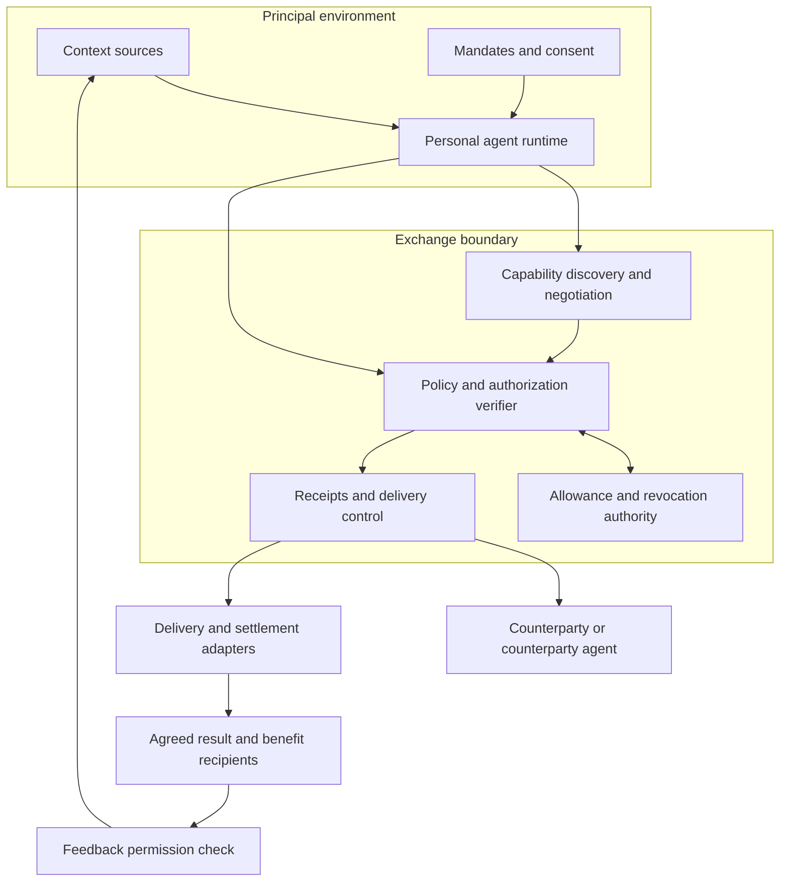
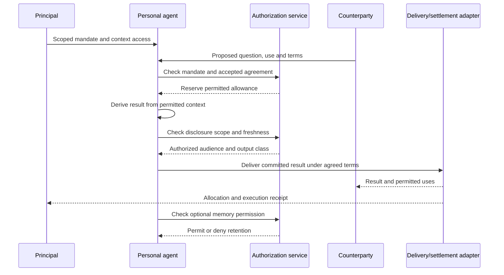

# Architecture

SDP separates personal information processing from external authority and fulfillment. These are logical boundaries; they may run on one device or across multiple services.

## Components

| Component | Responsibility | Must not assume |
|---|---|---|
| Context provider | Purpose-scoped access and retention controls | Access means unrestricted export |
| Agent runtime | Plan, transform and execute inside authority | A model can grant its own privileges |
| Mandate verifier | Authenticate binding, scope and freshness | Login equals all-purpose consent |
| Exchange coordinator | Negotiate and pin accepted terms | Operator can replace a principal's decision |
| Allowance authority | Atomic reservation and consumption across agents | Every delegate owns a fresh full quota |
| Delivery controller | Enforce audience and output scope | Private generation authorizes publication |
| Adapter | Perform domain-specific actions and settlement | Every domain needs a ledger or NFT |
| Receipt store | Preserve evidence and correction history | A digest establishes truth or secrecy |
| Feedback controller | Apply retention and memory authority | Every interaction should become memory |

A hosted agent can expose context to its model provider. Deployments must disclose that trust boundary; drawing a box around the principal environment does not prove local processing or confidentiality.

## A knowledge-service exchange

The diagram depicts logical responsibilities. It does not prescribe a centralized verifier or a synchronous transport. The profile defines proof formats, storage, encryption, failures and any prepayment or escrow path.

## Adapter boundary

A calendar adapter may execute a bounded scheduling request. A knowledge adapter may deliver an answer with usage terms. A marketplace adapter may coordinate an agreed exchange. A ledger adapter may issue or settle a tokenized result.

Every adapter must resolve the same questions: whose authority, what purpose, which scope, how much allowance, which recipient, what evidence and what residual operator power. Domain-specific states belong in the adapter profile.

## Wire profile checklist

A future interoperable implementation must define:

1. Identifier namespaces and authenticated principal-agent bindings.
2. Message encoding, canonicalization and exact signed bytes.
3. Audience and purpose comparison rules; opaque strings alone do not enforce intent.
4. Nonces, expiration, revocation freshness and replay storage.
5. Transactional allowance reservation, idempotency and reconciliation.
6. Confidential transport, context access and output delivery.
7. Receipt proofs, key rotation, retention and independent verification limits.
8. Domain error codes and terminal/unknown outcome handling.

The repository supplies semantic interfaces and examples. It does not yet supply this complete wire/runtime implementation.
