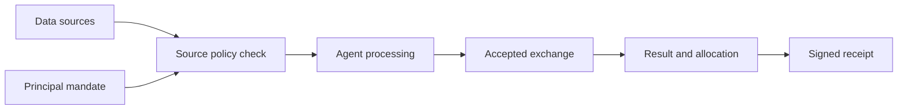
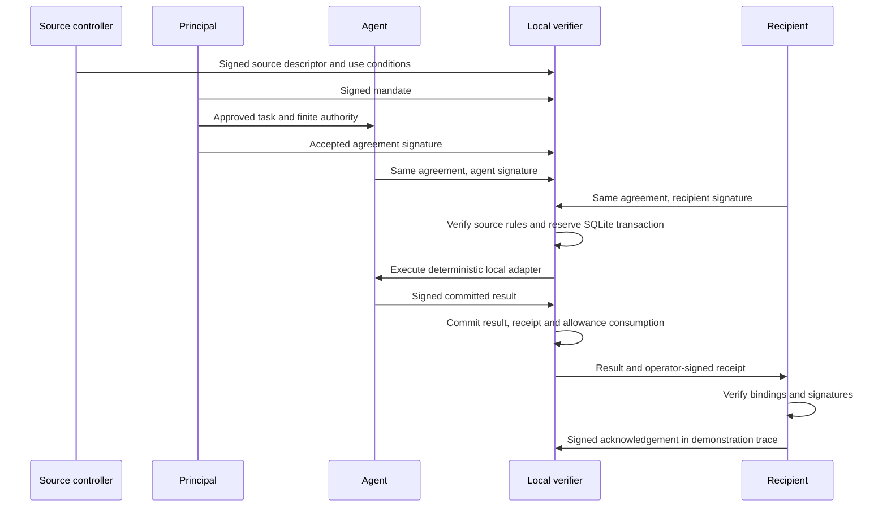

# Architecture

AGENT-SDP404 connects data-source conditions, execution authority and exchange evidence. A source may be controlled by a different party from the principal requesting the task.

Feedback is a separate authorized operation from the result back to a knowledge base, business system, device or Agent. It is intentionally outside the primary diagram so the data-to-exchange path remains readable.

## Source-aware components

| Component | Responsibility | Reference implementation |
|---|---|---|
| Source registry | Controller, snapshot, terms and disclosure policy | Signed source descriptors with synthetic snapshots |
| Identity registry | Bind identities to verifier-trusted keys | In-memory Ed25519 public-key registry |
| Mandate verifier | Check task authority, capability, purpose and limits | Signed mandate verification |
| Agreement coordinator | Pin terms and obtain party acceptance | Principal, agent and recipient signatures over one body |
| Agent executor | Process approved inputs | Deterministic local fixture adapters |
| Entitlement ledger | Serialize assignment, revocation and consumption | SQLite transactions and unique identifiers |
| Delivery verifier | Bind output to agreement and recipient | Agent result, operator receipt and recipient acknowledgement |
| State-update controller | Apply retained feedback or system changes | Normative extension; no automatic memory writes in the alpha |

## Concrete local exchange

The demo puts these roles in one process with separate keys. It demonstrates message and authority boundaries, not organizational independence or a distributed deployment.

## Atomicity boundary

Only effects inside the local SQLite transaction share its atomicity. Creation simulation, rights consumption and receipt persistence either commit together or roll back. An exact accepted-agreement replay reads the persisted response. Changed terms under the same exchange ID fail.

A real model API, remote delivery or blockchain transaction cannot simply be placed inside this transaction and called atomic. Such adapters need durable operation IDs, an outbox or equivalent coordination, and explicit UNKNOWN/reconciliation handling before reuse.

## Transport and integration boundary

MCP may supply tools/data connections and A2A may carry task interactions. An adapter must preserve the signed scope and evidence across those transports. This release supplies a local wire profile, not an MCP server, A2A service, DID resolver or blockchain adapter. See [positioning](positioning.md) and [the wire profile](../spec/SDP404-0004-local-wire.md).
